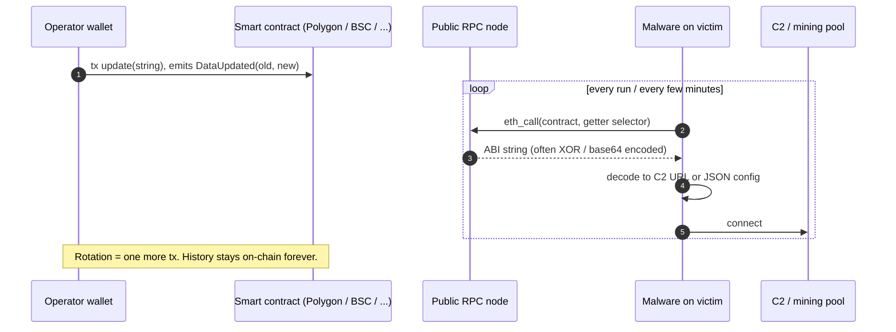

# deaddrop-hunter

[](https://github.com/tstefan-ws/deaddrop-hunter/actions/workflows/ci.yml)
[](https://github.com/tstefan-ws/deaddrop-hunter/actions/workflows/hunt.yml)
[](LICENSE)
[](#public-ioc-api)

**Hunting malware that hides its C2 and configuration on public blockchains ("EtherHiding").**

deaddrop-hunter sweeps public chains for the fingerprints of blockchain dead drops (event
topics, function selectors, known operator wallets), decodes the values stored in them,
extracts IOCs, clusters contracts by operator, and publishes everything as JSON, STIX 2.1,
a MISP feed, CSV/TXT blocklists, a static public API and a dashboard, refreshed every 6 hours
by GitHub Actions.

**Live dashboard:** <https://tstefan-ws.github.io/deaddrop-hunter/> ·
**Public IOC API:** <https://tstefan-ws.github.io/deaddrop-hunter/feeds/api/v1/index.json>

---

## How EtherHiding works

Instead of hard-coding a C2 server, the malware stores a pointer to it in a smart contract. Reading
a contract is a free, read-only `eth_call` to any public RPC node: there is no transaction, no
wallet and nothing to take down. When the C2 is burned, the operator sends one transaction and
every infected machine picks up the new value on its next poll.



That last line is the defender's advantage: **every rotation is permanently logged on-chain**,
so a single fingerprint (the event topic, the update selector or the operator wallet) reveals
the full history of C2s and configs, and often sibling contracts run by the same operator.

Further reading: Alex Necula's
[Hunting EtherHiding: from one cluster to an ecosystem](https://www.linkedin.com/pulse/hunting-etherhiding-from-one-cluster-ecosystem-alex-necula-r7l8e/)
(macOS ClickFix -> AMOS stealer, Polygon contracts), Google GTIG on
[UNC5142 / ClearFake on BNB Smart Chain](https://cloud.google.com/blog/topics/threat-intelligence/unc5142-etherhiding-distribute-malware)
and [DPRK UNC5342 adopting EtherHiding](https://cloud.google.com/blog/topics/threat-intelligence/dprk-adopts-etherhiding),
and Koi Security on [GlassWorm](https://www.koi.ai/blog/glassworm-first-self-propagating-worm-using-invisible-code-hits-openvsx-marketplace)
(Solana memo C2).

## Current findings

First sweep, **2026-10-19, Polygon** (`DataUpdated(string,string)` topic + update selectors):

| | |
|---|---|
| Contracts | **6** |
| On-chain config/C2 updates | **71** |
| Operator wallets | **3** |

- **Stealth XMRig cluster** - operator `0x19532c0fbaf0fb8c1d0f3fac0b704bf2f4645539` (4 contracts,
  update selector `0x68446ead`). The contracts store XMRig configs XOR-encoded with key `0x5a`.
  Decoded: pool `78.40.198[.]61` (earlier `xmr-eu1.nanopool[.]org`), stealth mode that pauses
  mining while `Taskmgr.exe` / `SystemInformer.exe` run.
- **XMRig config, hashvault pool** - operator `0x24d512cc549aaa8a0828f3336b88c55bad43c847`.
- **C2 URL rotation** - contract `0x1823a9a0ec8e0c25dd957d0841e3d41a4474badc` (selector
  `0xcef6d209`, operator `0xde275ad38c3352a7cb6b0d3efcbf45900c9716f2`) rotating C2 from
  `185.10.68[.]110` to `144.31.108[.]193`.

The dashboard always shows the current state; this table is a snapshot.

## Quick start

Requires Python >= 3.11. No API keys needed for the default chains.

```bash
git clone https://github.com/tstefan-ws/deaddrop-hunter.git
cd deaddrop-hunter
python3 -m venv .venv && source .venv/bin/activate     # Windows: .venv\Scripts\activate
pip install -e ".[dev]"

# 1. hunt (incremental: the next run continues from data/meta.json cursors)
deaddrop-hunter hunt --chains polygon --days 7

# 2. export feeds + public API into site/feeds
deaddrop-hunter export --data data --out site/feeds --formats stix,misp,csv,txt,api

# 3. assemble the static site (keeps site/feeds) and serve it
python scripts/build_site.py --out site
python -m http.server -d site 8080            # open http://localhost:8080
```

Other commands: `deaddrop-hunter rebuild` (re-derive contracts/IOCs/clusters from
`data/events.json` after changing decoders or classifiers), `deaddrop-hunter --help`.
With `make`: `make install`, `make all`, `make serve`.

### Optional secrets / environment variables

Copy `.env.example` to `.env` for local runs; in GitHub add them under
*Settings -> Secrets and variables -> Actions*. All are optional.

| Variable | Used for |
|---|---|
| `ETHERSCAN_API_KEY` | Etherscan V2 lookups on indexed chains. The free plan does **not** cover BSC (measured 2026-10-19). |
| `DUNE_API_KEY` | BSC event sweeps (`bnb.logs`) and selector hunts. |
| `TRONGRID_API_KEY` | Higher TronGrid rate limit for Tron account watches. |
| `DDH_RPC_BSC` | Free-key BSC RPC that allows topic-only `eth_getLogs`, as `url\|max_span` (NodeReal, Chainstack, Ankr). |
| `DDH_RPC_BSC_TESTNET` | Same for BSC testnet. |
| `DDH_RPC_SOLANA` | Solana RPC override (the public endpoint is heavily rate limited). |
| `VT_API_KEY` | VirusTotal enrichment (reserved). |

Any chain's RPC list can be overridden with `DDH_RPC_<CHAIN>` (e.g. `DDH_RPC_POLYGON`).

## Deploy

Full guide: **[docs/deploy.md](docs/deploy.md)** (GitHub Pages, WSL self-hosted, Docker).

**GitHub Pages (free, public repo):**
1. Push the repo to GitHub (`gh repo create tstefan-ws/deaddrop-hunter --public --source . --push`).
2. *Settings -> Pages -> Source: GitHub Actions*; *Settings -> Actions -> General -> Workflow
   permissions: Read and write*.
3. *Actions -> hunt -> Run workflow*. The dashboard appears at
   <https://tstefan-ws.github.io/deaddrop-hunter/> and refreshes every 6 hours.

**WSL (Ubuntu) quick start:**
```bash
git clone https://github.com/tstefan-ws/deaddrop-hunter.git ~/deaddrop-hunter && cd ~/deaddrop-hunter
bash scripts/bootstrap_wsl.sh            # venv + install + first short hunt + site
python3 -m http.server -d site 8080      # open http://localhost:8080 in Windows
```

**Docker:** `docker compose up -d --build` -> <http://localhost:8080>.

## Outputs

| Path | Format | Use |
|---|---|---|
| `data/*.json` | Source of truth ([schema](docs/data-schema.md)) | Git history = audit trail |
| `feeds/stix/deaddrop-hunter.bundle.json` | STIX 2.1 bundle (+ per-cluster bundles) | TIPs, OpenCTI |
| `feeds/misp/manifest.json` | MISP feed (manifest + events + `hashes.csv`) | MISP *Feeds -> Add feed* |
| `feeds/csv/{iocs,contracts,wallets}.csv` | CSV | Spreadsheets, SIEM lookups |
| `feeds/txt/{ipv4,ipv6,domains,urls}.txt` | One value per line | Firewall / proxy / DNS blocklists |
| `feeds/api/v1/...` | Static JSON API | Scripts, enrichment (see below) |
| `feeds/atom.xml` | Atom | Feed readers, chat notifications |
| `feeds/index.json` | Index of all exported files | Discovery |

All feed paths are relative to <https://tstefan-ws.github.io/deaddrop-hunter/>.

## Public IOC API

A free, static, versioned JSON API published on GitHub Pages with every hunt.

**Base URL:** `https://tstefan-ws.github.io/deaddrop-hunter/feeds/`

| Endpoint | Content |
|---|---|
| `api/v1/index.json` | List of endpoints with counts and sha256 |
| `api/v1/iocs.json` | All IOCs |
| `api/v1/iocs/current.json` | IOCs present in the *latest* value of at least one contract |
| `api/v1/iocs/<type>.json` | Per type: `ipv4`, `ipv6`, `domain`, `url`, `xmr-wallet`, `btc-wallet`, `evm-contract`, `evm-wallet` |
| `api/v1/families/<family>.json` | IOCs per malware family (e.g. `xmrig-stealth`) |
| `api/v1/chains/<chain>.json` | IOCs per chain (e.g. `polygon`) |
| `api/v1/contracts.json`, `wallets.json`, `clusters.json` | Entities |
| `api/v1/contracts/<chain>/<address>.json` | One contract with its events and IOCs |
| `api/v1/changes.json` | Newest 200 on-chain rotations (newest first) |
| `atom.xml` | Newest rotations / new contracts (defanged) |

Raw data: `https://raw.githubusercontent.com/tstefan-ws/deaddrop-hunter/main/data/<file>.json`.

Every API file is `{"schema_version", "generated_at", "license", "count", "data"}`; values in
`data` are **raw, not defanged** - never render them as links.

```bash
B=https://tstefan-ws.github.io/deaddrop-hunter/feeds/api/v1

# current C2 / pool IPs
curl -s $B/iocs/current.json | jq -r '.data[] | select(.type=="ipv4") | .value'

# everything known for the stealth XMRig family, as value:port
curl -s $B/families/xmrig-stealth.json | jq -r '.data[] | "\(.value):\(.port // "")"'

# latest rotations
curl -s $B/changes.json | jq '.data[:5]'

# one contract with its full update history
curl -s $B/contracts/polygon/0x1823a9a0ec8e0c25dd957d0841e3d41a4474badc.json | jq '.data'
```

- **Update cadence:** every 6 hours (scheduled hunt), plus on every dashboard deploy.
- **License:** data is **CC0-1.0, TLP:CLEAR**; code is MIT. Provided as is, without warranty.
- **Fair use:** it is static and cache-friendly (served by GitHub's CDN). Poll at most every
  hour, use `If-None-Match`/`If-Modified-Since`, and check `index.json` sha256 before downloading
  large files. Please don't hammer it.

## Integrations

SIEM/TIP integrations (MISP, OpenCTI connector in `connectors/opencti/`, Splunk/Elastic/Sentinel
lookups) are documented in **[docs/integrations.md](docs/integrations.md)**. Detection content:

- `rules/sigma/` - 7 Sigma rules: non-browser processes talking to blockchain RPC hosts (Windows
  DNS/network, macOS network), macOS LaunchAgent plist by script, `tccutil reset All`, ClickFix
  RunMRU, `eth_call` on the command line. Tuning notes in [rules/sigma/README.md](rules/sigma/README.md).
- `rules/yara/` - 7 YARA rules: RPC + `eth_call` loaders, `DataUpdated(string,string)` topic,
  stealth XMRig configs (plain, XOR 0x5a as stored on-chain, any single-byte XOR).
- `rules/suricata/` - 45 informational rules: DNS / TLS SNI to public RPC endpoints, JSON-RPC
  `eth_call` over HTTP (SIDs 9100001-9100203).

## Repository layout

```
deaddrop-hunter/
├── config/hunts.toml          chains, RPCs (with measured log-span limits), hunts, watch wallets
├── src/deaddrop_hunter/       the hunter (CLI, collectors, providers, decoders, classify, build)
│   ├── collectors/            event sweep, selector sweep, wallet watch (EVM)
│   ├── providers/             Etherscan V2, Dune
│   ├── nonevm/                Tron, Solana (memo), Aptos account watches
│   └── exporters/             STIX, MISP, CSV/TXT, static API + Atom
├── data/                      results (JSON, committed by CI)
├── web/                       static dashboard (vanilla JS)
├── scripts/                   build_site.py, run_hunt.sh, bootstrap_wsl.sh
├── rules/                     sigma/, yara/, suricata/
├── connectors/opencti/        OpenCTI external-import connector
├── docs/                      methodology, providers, architecture, deploy, schema, integrations
├── tests/                     pytest suites
└── .github/                   workflows (hunt, deploy-pages, ci), issue forms, PR template
```

## Safety and ethics

- **Read-only.** The hunter only calls read methods (`eth_blockNumber`, `eth_getLogs`,
  `eth_getTransactionByHash`, `eth_getBlockByNumber`, `eth_getCode`, `eth_call`, and read-only
  REST/JSON-RPC on non-EVM chains). It never signs or sends transactions.
- **Never visits IOCs.** Decoded C2s, pools and URLs are never resolved, fetched or connected
  to. The dashboard defangs them and never makes them clickable. You shouldn't visit them either.
- **TLP:CLEAR.** Everything here is derived from public blockchain data and is shareable.
- **False positives happen.** An event signature can be reused by a legitimate contract. Check
  the decoded values and history before blocking, and
  [report false positives](https://github.com/tstefan-ws/deaddrop-hunter/issues/new?template=false-positive.yml).
- **Responsible disclosure.** Contracts can't be taken down, but they can be labeled and their
  infrastructure disrupted: report contracts and operator wallets to the explorers
  (Polygonscan/Etherscan/BscScan "Report/Flag address") so wallets and users get warned, report
  the infrastructure to its hosting provider/registrar and to abuse.ch (ThreatFox/URLhaus), and let
  RPC providers know when their endpoints are abused at scale.

## Contributing

New fingerprints, decoders, chains, rules and false-positive reports are very welcome. See
[CONTRIBUTING.md](CONTRIBUTING.md), [docs/adding-a-hunt.md](docs/adding-a-hunt.md),
[docs/methodology.md](docs/methodology.md) and [docs/architecture.md](docs/architecture.md).
Use the issue forms to
[report a suspicious contract or wallet](https://github.com/tstefan-ws/deaddrop-hunter/issues/new?template=report-contract.yml).
Security issues in the tool itself: [SECURITY.md](SECURITY.md).

## Credits

- **Alex Necula** - the EtherHiding cluster research that started this project.
- **Google Threat Intelligence Group (GTIG)** - UNC5142 / ClearFake and DPRK UNC5342 EtherHiding reporting.
- Guardio Labs, who named EtherHiding in 2023, and Koi Security for GlassWorm.
- Free infrastructure that makes public hunting possible: Tenderly, PublicNode, Dune, abuse.ch,
  GitHub Pages and Actions.

## License

Code: [MIT](LICENSE) © 2026 deaddrop-hunter contributors. Data (`data/`, feeds, API): CC0-1.0, TLP:CLEAR.
