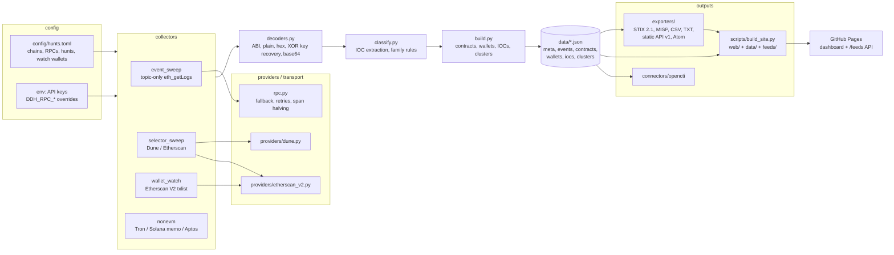
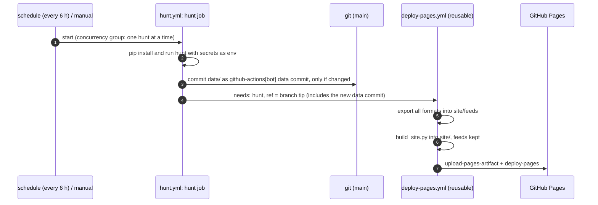

# Architecture

deaddrop-hunter is a stdlib-only Python package (`src/deaddrop_hunter/`) plus a static
dashboard (`web/`). Git is the database: `data/*.json` is committed after every hunt, so the
history of every finding is auditable and diffable.

## Pipeline

| Module | Responsibility |
|---|---|
| `cli.py` | `hunt`, `rebuild`, `export`, `read` subcommands |
| `config.py` | Parse `hunts.toml`; computes topic0/selectors from signatures; applies `DDH_RPC_<CHAIN>` overrides |
| `rpc.py`, `http.py` | Read-only JSON-RPC client: endpoint fallback, retries/backoff on rate limits, `eth_getLogs` span halving |
| `collectors/event_sweep.py` | Topic-only log sweeps per chain within each RPC's `max_log_span`; Dune for chains with `indexed_provider = "dune"` |
| `collectors/selector_sweep.py` | Transactions whose input starts with a selector (Dune; Etherscan fallback for known contracts) |
| `collectors/wallet_watch.py` | Every tx of watched operator wallets: creations, string-setter calls, unknown calls |
| `nonevm/` | Tron, Solana (memo), Aptos account watches; returns events in the same schema |
| `providers/` | Dune and Etherscan V2 clients (`ProviderUnavailable` when no key: hunt skipped, not failed) |
| `decoders.py` | ABI decoding and the ordered value-decoder chain |
| `classify.py` | IOC extraction/validation, family rules |
| `build.py` | Derives all files from `events.json`: per-contract state, operator wallets, IOC aggregation, union-find clustering, status (`active` < 30 days) |
| `store.py` | Deterministic JSON I/O (sorted, 2-space indent) and cursors in `meta.json` |
| `hunt.py` | Orchestration: plan block ranges from cursors, run collectors, merge new events, rebuild |
| `exporters/` | STIX 2.1, MISP feed, CSV/TXT, static JSON API + Atom, `feeds/index.json` |
| `scripts/build_site.py` | Copies `web/` (minus `sample-data/`) and `data/` into `site/`, keeps `site/feeds/`, writes `.nojekyll` |

Key design rules:

- **Events are the only primary data.** Everything else in `data/` is derived by `build.py`, so
  `deaddrop-hunter rebuild` (no network) re-applies new decoders/classifiers to all history.
- **Incremental.** Cursors per (chain, hunt) in `meta.json`; each run continues at `to_block + 1`
  and stays 5 blocks behind head.
- **Read-only and IOC-safe.** No signing, no sending; decoded values are attacker-controlled and
  never fetched; renderers defang.
- **Degrade, don't fail.** Missing keys or refusing endpoints skip that hunt/chain and are reported
  as `skipped`; the run fails only if nothing ran.
- **Deterministic output** keeps git diffs small and reviewable.

## Data flow in CI

- `deploy-pages.yml` also runs on its own when `web/**`, `scripts/build_site.py` or the exporters
  change on `main`, and on manual dispatch. One deployment runs at a time (`concurrency: pages`).
- `ci.yml` runs on push/PR: ruff + pytest (Python 3.11-3.13), `node --check` for `web/**/*.js`,
  JSON validation of `data/` and `web/sample-data/`, a site-build smoke test, `sigma check`,
  YARA compile (libyara + YARA-X) with a positive control, `suricata -T` on the Suricata rules,
  SID range check, and `bash -n` + shellcheck on `scripts/*.sh`.
- Data commits made with `GITHUB_TOKEN` do not trigger other workflows; that is why `hunt.yml`
  calls the deploy workflow directly.

## Self-hosted flow (WSL / Linux / Docker)

`scripts/run_hunt.sh` does the same three steps locally (hunt -> export -> build_site), loading
`.env` and using `.venv`; `--push` commits and pushes `data/` so a GitHub Pages deployment can
still serve the dashboard. Cron, systemd timers and Docker Compose setups are in
[deploy.md](deploy.md).
